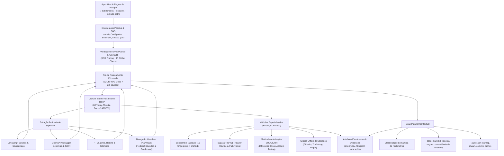

# ReconForge

<div align="center">

```ascii
  ██████╗ ███████╗ ██████╗ ██████╗ ███╗   ██╗███████╗ ██████╗ ██████╗  ██████╗ ███████╗
  ██╔══██╗██╔════╝██╔════╝██╔═══██╗████╗  ██║██╔════╝██╔═══██╗██╔══██╗██╔════╝ ██╔════╝
  ██████╔╝█████╗  ██║     ██║   ██║██╔██╗ ██║█████╗  ██║   ██║██████╔╝██║  ███╗█████╗  
  ██╔══██╗██╔══╝  ██║     ██║   ██║██║╚██╗██║██╔══╝  ██║   ██║██╔══██╗██║   ██║██╔══╝  
  ██║  ██║███████╗╚██████╗╚██████╔╝██║ ╚████║██║     ╚██████╔╝██║  ██║╚██████╔╝███████╗
  ╚═╝  ╚═╝╚══════╝ ╚═════╝ ╚═════╝ ╚═╝  ╚═══╝╚═╝      ╚═════╝ ╚═╝  ╚═╝ ╚═════╝ ╚══════╝
```

**Advanced Autonomous Attack Surface Reconnaissance & Intelligence Pipeline for Bug Bounty**

[](https://python.org)
[](#-testes-automatizados)
[](#-arquitetura-e-fluxo-de-dados)
[](#-defesas-de-segurança-e-integridade-operacional)
[](LICENSE)

[Visão Geral](#-visão-geral) •
[Diferenciais](#-principais-diferenciais) •
[Instalação](#-instalação) •
[Guia de Uso](#-guia-de-uso) •
[Módulos de Segurança](#-módulos-de-segurança-findings-oriented) •
[Scan Planner](#-roteamento-inteligente-de-scanners-scan-planner) •
[Artefatos](#-artefatos-gerados) •
[Garantias e Hardening](#-defesas-de-segurança-e-integridade-operacional)

</div>

---

## 🧭 Visão Geral

O **ReconForge** é uma plataforma de reconhecimento ativo e passivo orientada a **Bug Bounty e Red Teaming**, construída em Python moderno (`asyncio`, `httpx`, `sqlite3`). 

Projetado para substituir scripts legados baseados em pipes Bash que frequentemente vazavam requisições fora de escopo, travavam por falta de controle de taxa ou disparavam scanners cegamente contra URLs irrelevantes, o ReconForge implementa um pipeline com:

1. **Escopo Estrito com DNS Pinning:** O transporte HTTP próprio valida endereços IP via DNS antes do handshake, fixa o IP na conexão e rejeita destinos privados (anti-SSRF e anti-DNS Rebinding) sem perder validação TLS/SNI.
2. **Isolamento Criptográfico e Credenciais Seguras:** Provedores passivos (ex: Certificate Transparency) **nunca** recebem cookies ou headers privados. Sessões de auditoria (anônima e identidades autenticadas) possuem *cookie jars* e *connection pools* completamente independentes.
3. **Persistência Relacional Concorrente (SQLite WAL):** Resumabilidade real com deduplicação atômica de URLs, rastreabilidade de procedência (`url_sources`), trava exclusiva contra execuções conflitantes no mesmo diretório e orçamento de requisições **cumulativo** (interromper e continuar não excede o teto contratual do programa).
4. **Scan Planner Contextual:** Em vez de "spray and pray", o motor analisa a semântica de cada parâmetro HTTP (`id`, `order` → SQLi; `cmd`, `exec` → CMDi; `q`, `search` → XSS; `url`, `redirect` → SSRF/Redirect) e propõe um plano cirúrgico (`scan_plan.sh` e `scan_plan.json`), executável opcionalmente via `--auto-scan`.

---

## 🏗 Arquitetura e Fluxo de Dados



---

## ⚡ Principais Diferenciais

| Recurso | Pipelines Antigos (Bash/Scripts) | ReconForge |
| :--- | :--- | :--- |
| **Linguagem & Runtime** | Bash frágil acoplado a utilitários GNU e pipes Unix | Python 3.10+ nativo, assíncrono e tipado (`asyncio`) |
| **Compatibilidade** | Apenas Linux/Kali | Multiplataforma nativo: **Linux, WSL2, macOS e Windows** |
| **Garantia de Escopo** | Regexes pós-coleta que não impedem requests externos | **Barreira pré-transporte**: DNS Pinning, bloqueio estrito e rejeição OOS |
| **Segurança Operacional** | Dispara POST/DELETE ou endpoints de logout acidentalmente | **GET-only estrito**; isola rotas perigosas (`/logout`, `/delete`) para auditoria manual |
| **Gestão de Segredos** | Headers e tokens impressos em texto puro nos relatórios e logs | Segredos privados mascarados com variáveis de ambiente e hashes SHA-256 |
| **Isolamento de Contas** | Mistura cookies de contas de teste | Sessões de usuário estritamente separadas por origem e identidade |
| **Retomada de Sessão** | Reexecuta requests ou perde estado se interrompido | **Resume determinístico com SQLite WAL** e trava de processo contra corrida |
| **Roteamento de Scanners** | Dispara todos os scanners contra todas as URLs | **Scan Planner**: mapeia ferramenta exata para a classe de parâmetro |

---

## 📦 Instalação

### Pré-requisitos
- **Python 3.10 ou superior** (Testado no Python 3.10, 3.11, 3.12 e 3.14).
- `git`

### 1. Clonar e Configurar Ambiente Virtual

#### No Linux / Kali / macOS / WSL2:
```bash
git clone https://github.com/marcostolosa/Recon.git reconforge
cd reconforge/
python3 -m venv .venv
source .venv/bin/activate
pip install -r requirements.txt
```

#### No Windows (PowerShell):
```powershell
git clone https://github.com/marcostolosa/Recon.git reconforge
cd reconforge
python -m venv .venv
.venv\Scripts\Activate.ps1
pip install -r requirements.txt
```

### 2. (Opcional) Instalar Suporte a Browser Dinâmico (Playwright)
Para capturar tráfego de SPAs e sites que renderizam links via client-side JavaScript:
```bash
playwright install chromium
```

### 3. Verificação e Instalação Automática de Ferramentas Externas
O ReconForge possui um **gerenciador integrado de ferramentas** que verifica automaticamente se os utilitários necessários (`subfinder`, `amass`, `gau`, `katana`, `ffuf`, `nuclei`, `dalfox`, `sqlmap`, `ghauri`, `commix`, `gitleaks`, `trufflehog`, `dnspython` e `playwright`) estão presentes no sistema e **instala automaticamente** (via `go install` ou `pip`) caso estejam ausentes:

```bash
# Verificar status de todas as ferramentas no sistema:
python reconforge.py --check-tools

# Instalar automaticamente todas as ferramentas externas suportadas:
python reconforge.py --install-tools
```

> *Nota:* Por padrão na CLI (`--auto-install`), o ReconForge checa e instala sob demanda qualquer ferramenta exigida pelas flags ativas da execução. Use `--no-auto-install` caso deseje desabilitar a instalação automática.

---

## 🚀 Guia de Uso

### 1. Reconhecimento Passivo Estrito
Consulta bases de certificados SSL/TLS (crt.sh, CertSpotter) e fontes públicas históricas sem tocar no alvo:
```bash
python reconforge.py example.com --subdomains --passive-only --out runs/example-passive
```

### 2. Reconhecimento Ativo Completo Autorizado
Varredura aprofundada com crawling recursivo, extração de JavaScript, sourcemaps e fuzzing orçado:
```bash
python reconforge.py example.com \
  --subdomains \
  --exclude dev.example.com \
  --exclude-path /logout \
  --exclude-path /billing \
  --katana \
  --fuzz \
  --rate 5 \
  --concurrency 10 \
  --max-hosts 300 \
  --max-probes 4000 \
  --max-requests 6000 \
  --out runs/example-full
```

### 3. Cabeçalho Obrigatório de Identificação (Bug Bounty Program Compliance)
Plataformas como HackerOne, Bugcrowd e Intigriti frequentemente exigem identificação de tráfego:
```bash
python reconforge.py example.com --subdomains \
  -H "X-Bug-Bounty: hackerone-username" \
  -H "Contact: researcher@security.org" \
  --out runs/example-scoped
```

---

## 🎯 Módulos de Segurança (Findings-Oriented)

Todos os módulos de segurança do ReconForge operam estritamente via **GET**, respeitam os limites de requisições e são ativados conforme o objetivo da auditoria:

### 🔍 1. Detecção de Subdomain Takeover
Varre subdomínios in-scope em busca de 16 assinaturas de serviços de nuvem abandonados (GitHub Pages, AWS S3, Heroku, Shopify, Fastly, Azure, etc.) e integra com `dnspython` para acusar CNAMEs apontando para domínios inexistentes (`cname_nxdomain`):
```bash
python reconforge.py example.com --subdomains --takeover --out runs/example-takeover
```
*Saída gerada:* `takeover_candidates.jsonl`.

### 🚪 2. Bypass de 403 / 401 Forbidden
Reataca endpoints proibidos usando 9 headers de reescrita de IP/Proxy (`X-Forwarded-For`, `X-Custom-IP-Authorization`, `X-Original-URL`, etc.) e 11 técnicas conservadoras de path rewrite (`/..;/`, `/%2e/`, etc.). Só notifica se retornar `2xx` com corpo e hash comprovadamente distintos do erro original:
```bash
python reconforge.py example.com --subdomains --bypass-403 --bypass-limit 50 --out runs/example-bypass
```
*Saída gerada:* `bypass403_candidates.jsonl`.

### 👥 3. Matriz de Autorização BOLA / IDOR
Executa testes diferenciais entre múltiplas contas autorizadas para identificar vulnerabilidades de controle de acesso horizontal e vertical:
```bash
python reconforge.py example.com --subdomains \
  --identity "UserA:Authorization: Bearer <TOKEN_CONTA_A>" \
  --identity "UserB:Authorization: Bearer <TOKEN_CONTA_B>" \
  --authz-limit 50 \
  --out runs/example-authz
```
*Saídas geradas:* `bola_candidates.jsonl` (candidatos triados) e `authz_matrix.csv` (matriz bruta para evidência).

---

## 🧠 Roteamento Inteligente de Scanners (Scan Planner)

Em vez de disparar scanners de forma indiscriminada contra toda a superfície, o ReconForge analisa a semântica dos parâmetros descobertos:

- **SQL Injection (`id`, `user`, `order_by`, `cat`, etc.):** Roteia para `sqlmap` e `ghauri`.
- **Command Injection (`cmd`, `exec`, `ping`, `host`, etc.):** Roteia para `commix`.
- **Cross-Site Scripting (`q`, `search`, `msg`, `callback`, etc.):** Roteia para `dalfox`.
- **SSRF / Open Redirect (`url`, `dest`, `redirect`, `next`, etc.):** Isola para validação com templates Nuclei ou manual.
- **Path Traversal / LFI (`file`, `path`, `folder`, `doc`, etc.):** Isola para validação com templates Nuclei ou manual.

### Como usar o Planner:

#### Modo Proposta (Padrão — Seguro & Recomendado)
Gera o plano estruturado sem disparar nada. O pesquisador pode inspecionar antes de rodar:
```bash
python reconforge.py example.com --subdomains --out runs/example-target
```
Inspecione os arquivos criados:
- `scan_plan.json`: Metadados completos da rota e parâmetros.
- `scan_plan.sh`: Script bash com comandos preparados contendo `shlex.quote` e substituição de segredos via variáveis de ambiente.

#### Modo Execução Automática (`--auto-scan`)
Dispara automaticamente apenas as ferramentas disponíveis no `PATH`:
```bash
python reconforge.py example.com --subdomains \
  --auto-scan \
  --scan-profile fast \
  --rate 10 --concurrency 8 \
  --scan-plan-limit 100 \
  --out runs/example-autoscan
```

### Perfis de Varredura (`--scan-profile`):
- `safe`: `sqlmap --level 1 --risk 1`, `dalfox` com 1 worker.
- `fast` (Padrão): Alta concorrência, `sqlmap --level 3 --risk 2 --threads 10`, `dalfox --mining` com 40 workers.
- `deep`: Cobertura profunda, `sqlmap --level 5 --risk 3`, `dalfox --deep-domxss`.

---

## 📁 Artefatos Gerados

Todos os achados são gravados em tempo real na pasta configurada em `--out`:

| Arquivo | Descrição |
| :--- | :--- |
| `state.sqlite` | Banco de dados SQLite relacional em modo WAL (inventário, status, metadados e fila de URLs). |
| `priority.csv` | Fila ordenada de URLs por pontuação de risco e interesse com indicador de Soft-404. |
| `subdomains.txt` | Lista limpa e deduplicada de subdomínios in-scope resolvidos. |
| `urls.txt` | Lista completa de URLs descobertas dentro do escopo. |
| `alive.txt` | Endpoints que responderam HTTP 2xx ou 3xx. |
| `parameterized.txt` | Endpoints vivos que recebem query strings (alvos primários de injeção). |
| `javascript.txt` | Inventário de scripts `.js`, `.mjs` e sourcemaps `.map`. |
| `manual-review-only.txt` | Rotas perigosas (ex: `/logout`, `/delete`) ou formulários POST preservados sem execução automática. |
| `http.jsonl` | Respostas HTTP estruturadas com código, content-type, tamanho, título e hash SHA-256 do corpo. |
| `secret_indicators.jsonl` | Chaves/tokens descobertos em JS (salvos apenas como fingerprints SHA-256 para evitar vazamento). |
| `url_provenance.jsonl` | Histórico exato de qual ferramenta ou crawler descobriu cada URL. |
| `takeover_candidates.jsonl` | Subdomínios com evidência de serviço dangling ou CNAME NXDOMAIN. |
| `bypass403_candidates.jsonl` | Endpoints protegidos que cederam a truques de bypass. |
| `bola_candidates.jsonl` | Discrepâncias de autorização identificadas entre contas de teste. |
| `authz_matrix.csv` | Matriz bruta comparativa de respostas por identidade (`anon`, `UserA`, `UserB`). |
| `scan_plan.json` / `.sh` | Plano de teste contextual de scanners gerado pelo motor de inteligência. |
| `js/*.js` | Cópia local de todos os arquivos JavaScript baixados para engenharia reversa offline. |
| `tools/*.stdout` / `.stderr` | Logs brutos de execução de ferramentas externas para fins de auditoria. |

---

## 🔒 Defesas de Segurança e Integridade Operacional

O ReconForge foi submetido a uma rigorosa bateria de auditoria de segurança estática e dinâmica para garantir conformidade em programas de Bug Bounty:

1. **DNS Pinning Anti-SSRF:** O motor resolve o host via resolver local assíncrono, valida se pertence a bloco de IP público (RFC 1918 e metadados de cloud bloqueados por padrão) e conecta diretamente ao IP validado preservando o cabeçalho `Host` e o TLS Server Name Indication (SNI).
2. **Proteção de Credenciais contra Vazamento em CT:** Requisições a serviços públicos de Certificate Transparency (`crt.sh`, `certspotter`) utilizam um cliente HTTP completamente isolado, sem acesso a tokens, cookies ou headers privados.
3. **Barreira Estrita de Exclusões:** Se uma rota for excluída via `--exclude-path` ou um host via `--exclude`, o transporte HTTP bloqueia o envio imediatamente, impedindo que requisições acidentais saiam da máquina.
4. **Isolamento de Contas e Cookie Jars:** As identidades configuradas em `--identity` não compartilham cookies nem tokens com a sessão de descoberta ou com a identidade anônima.
5. **Orçamento Cumulativo Anti-Estouro:** O contador de requisições é armazenado atomicamente no SQLite. Reiniciar o script com `--out` repetido continuará consumindo o saldo restante, garantindo que o teto autorizado nunca seja ultrapassado.
6. **Exclusividade de Execução:** Um mecanismo de *file lock* impede que duas instâncias do ReconForge executem simultaneamente no mesmo diretório de saída, prevenindo corrupção de dados.

---

## 🧪 Testes Automatizados

O projeto conta com uma suíte de testes unitários e de integração de segurança abrangente, rodando offline em ambiente simulado:

```bash
# Executar todos os 46 testes automatizados:
python -m unittest discover -s tests -v
```

```text
Ran 46 tests in 2.628s
OK
```

Para executar a auditoria offline de segurança dedicada:
```bash
python audit_reconforge_offline.py
```

---

## 🗺️ Roadmap de Evolução

- [x] Motor Python assíncrono modular com persistência SQLite WAL.
- [x] Validação estrita de escopo, anti-SSRF e DNS Pinning.
- [x] Scan Planner semântico com geração de propostas `scan_plan.sh`.
- [x] Módulos de Takeover, 403 Bypass e Matriz BOLA/IDOR.
- [ ] Mapeamento automático de rotas via Websockets.
- [ ] Exportação de relatórios prontos em formato Markdown/PDF para envio direto ao HackerOne/Bugcrowd.
- [ ] Geração automática de templates Nuclei personalizados a partir dos schemas OpenAPI descobertos.

---

## ⚖️ Aviso Legal & Uso Ético

> **IMPORTANTE:** O ReconForge foi desenvolvido exclusivamente para fins de auditoria de segurança, testes de intrusão autorizados e programas formais de Bug Bounty. O uso desta ferramenta contra alvos sem autorização prévia por escrito é ilegal. Os desenvolvedores e mantenedores não se responsabilizam pelo uso indevido deste software.
