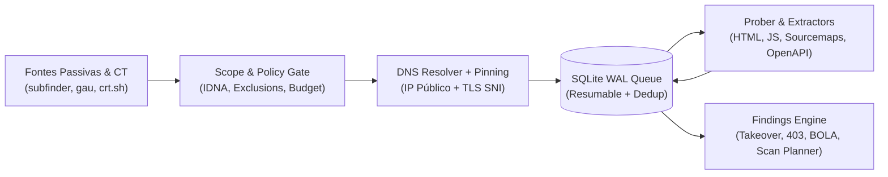

# ReconForge v2.0

<div align="center">

```text
  ____                      _____                    
 |  _ \ ___  ___ ___  _ __ |  ___|__  _ __ __ _  ___ 
 | |_) / _ \/ __/ _ \| '_ \| |_ / _ \| '__/ _` |/ _ \
 |  _ <  __/ (_| (_) | | | |  _| (_) | | | (_| |  __/
 |_| \_\___|\___\___/|_| |_|_|  \___/|_|  \__, |\___|
                                          |___/      
```

**Scoped, Resumable & Findings-Oriented Bug Bounty Reconnaissance Engine**

[](https://python.org)
[](#-testes--auditoria)
[](#-under-the-hood-para-os-nerds)
[](#-under-the-hood-para-os-nerds)
[](#-interface-visual-rich-tui)

[Quick Start](#-quick-start-30s) •
[Receitas Prontas](#-receitas-prontas-copy--paste) •
[Módulos de Findings](#-módulos-de-findings--scan-planner) •
[Under the Hood (Nerds)](#-under-the-hood-para-os-nerds) •
[Artefatos](#-artefatos-gerados) •
[Flags](#-cheatsheet-de-flags)

</div>

---

## 💡 O que é o ReconForge?

O **ReconForge** transforma um domínio autorizado em um inventário priorizado de superfície de ataque e potenciais vulnerabilidades — **sem estourar escopo, sem disparar scanners às cegas e sem perder horas de trabalho se a conexão cair**.

Em vez de scripts Bash frágeis que encadeiam ferramentas sem controle de tráfego, o ReconForge usa um motor Python `asyncio` com banco **SQLite WAL**, **DNS Pinning** anti-rebinding, instalador automático de ferramentas (`--check-tools` / `--install-tools`) e um **Intelligent Scan Planner** que analisa cada parâmetro descoberto para decidir exatamente qual scanner (`sqlmap`, `ghauri`, `dalfox`, `commix`, `nuclei`) deve rodar onde.

---

## ⚡ Quick Start (30s)

```bash
# 1. Clone e instale as dependências Python (httpx, rich, dnspython, playwright)
git clone https://github.com/marcostolosa/Recon.git reconforge
cd reconforge
python -m venv .venv
source .venv/bin/activate  # No Windows PowerShell: .venv\Scripts\Activate.ps1
pip install -r requirements.txt

# 2. Verifique (e instale automaticamente) as ferramentas externas do ecossistema
python reconforge.py --check-tools
python reconforge.py --install-tools

# 3. Rode seu primeiro recon com TUI interativa!
python reconforge.py example.com --subdomains --out runs/example
```

> **Auto-Install Inteligente:** Esqueceu de instalar o `subfinder`, `katana` ou `dalfox`? Ao rodar qualquer comando na CLI, o ReconForge detecta quais binários faltam para as flags escolhidas e os instala automaticamente via `go install` / `pip` (desative com `--no-auto-install` se preferir).

---

## 🖥️ Interface Visual (Rich TUI)

Quando executado no terminal, o ReconForge exibe divisores por fase, barras de progresso em tempo real com telemetria de fila/orçamento e tabelas detalhadas de findings:

```text
┌─────────────────── ReconForge v2.0 — Bug Bounty Pipeline ───────────────────┐
│     ____                      _____                                         │
│    |  _ \ ___  ___ ___  _ __ |  ___|__  _ __ __ _  ___                      │
│    | |_) / _ \/ __/ _ \| '_ \| |_ / _ \| '__/ _` |/ _ \                     │
│    |  _ <  __/ (_| (_) | | | |  _| (_) | | | (_| |  __/                     │
│    |_| \_\___|\___\___/|_| |_|_|  \___/|_|  \__, |\___|                     │
│                                             |___/                           │
│    target  example.com                                                      │
│     scope  apex + subdomains                                                │
│   profile  fast  •  rate 5.0/s  •  conc 10                                  │
│    budget  4000 probes / 6000 requests                                      │
│    output  runs/example                                                     │
│   modules  [CT] [subfinder] [gau] [katana] [takeover] [403-bypass]          │
└─────────────── authorized scope only • GET-safe • DNS-pinned ───────────────┘
────────────────── Fase 2 • Resolução DNS, Pinning & Probing ──────────────────
┌─────────── discovery ────────────┐    ┌────────── findings ──────────┐
│    subdomains   48               │    │ finding                count │
│ urls in scope   1,420            │    │ ──────────────────────────── │
│         alive   312              │    │ subdomain takeover         1 │
│        probed   640  (0 pending) │    │ 403/401 bypass             2 │
│      requests   715              │    │ BOLA / IDOR                0 │
│ manual-review   14               │    │ JS secret indicators       3 │
└──────────────────────────────────┘    │ scan-plan endpoints       18 │
                                        └──────────────────────────────┘
```
*(Em pipes, CI/CD ou redirecionamento de arquivo, o output degrada automaticamente para logs limpos e `grep`-friendly).*

---

## 🧪 Receitas Prontas (Copy & Paste)

### 1. Recon Passivo (Zero Tráfego no Alvo)
Coleta apenas via Certificate Transparency (`crt.sh`, `CertSpotter`), `subfinder`, `amass` e histórico (`gau`/Wayback):
```bash
python reconforge.py example.com --subdomains --passive-only --out runs/passive
```

### 2. Recon Ativo Completo + Identificação do Programa (VDP / Bug Bounty)
Inclui headers exigidos pelo programa, exclui rotas sensíveis, faz crawling JS/Sourcemaps e fuzzing com calibração de Soft-404:
```bash
python reconforge.py example.com --subdomains \
  -H "X-Bug-Bounty: hackerone-seuuser" \
  --exclude status.example.com \
  --exclude-path /logout \
  --katana --fuzz --bypass-403 \
  --rate 5 --concurrency 10 \
  --out runs/active
```

### 3. Caça a BOLA / IDOR (Matriz de Autorização Multi-Conta)
Compara respostas entre duas sessões de teste e anônimo (cookies e conexões 100% isolados por identidade):
```bash
python reconforge.py api.example.com \
  --identity "UserA:Authorization: Bearer <TOKEN_A>" \
  --identity "UserB:Authorization: Bearer <TOKEN_B>" \
  --authz-limit 80 \
  --out runs/bola-audit
```

### 4. Recon + Execução Automática do Scan Planner (`--auto-scan`)
Descobre a superfície, classifica parâmetros injetáveis, limpa payloads sujos do Wayback e dispara os scanners adequados:
```bash
python reconforge.py example.com --subdomains \
  --katana --auto-scan --scan-profile fast \
  --rate 5 --concurrency 8 \
  --out runs/autoscan
```

---

## 🎯 Módulos de Findings & Scan Planner

| Módulo | Como Funciona | Artefato |
| :--- | :--- | :--- |
| **Subdomain Takeover** | 16 assinaturas de cloud (S3, GitHub Pages, Heroku, Fastly, Azure...) + detecção de `CNAME NXDOMAIN` via `dnspython`. | `takeover_candidates.jsonl` |
| **403 / 401 Bypass** | Testa 9 headers (`X-Original-URL`, `X-Forwarded-For`, etc.) e 11 variações de path (`/..;/`, `/%2e/`). Valida hash do corpo para evitar falso positivo. | `bypass403_candidates.jsonl` |
| **BOLA / IDOR Matrix** | Replay diferencial (`UserA` vs `UserB` vs `anon`). Distingue `likely_bola` (200 idêntico só para autenticados) de recursos públicos. | `bola_candidates.jsonl` & `authz_matrix.csv` |
| **JS & Secret Hunting** | Extrai endpoints de bundles `.js` e `.map` (sourcemaps), aplica regex de chaves (AWS, GCP, GitHub, Slack, Private Keys) + `gitleaks` / `trufflehog` offline. | `secret_indicators.jsonl` & `js/*.js` |
| **Scan Planner** | Classifica parâmetros por semântica (`sqli`, `xss`, `cmdi`, `ssrf`, `lfi`), gera script auditável (`scan_plan.sh`) e roda com `--auto-scan`. | `scan_plan.json` & `scan_plan.sh` |

### Roteamento Semântico do Scan Planner
- **SQLi (`id`, `user_id`, `order`, `sort`, `cat`, `item`...):** `sqlmap`, `ghauri`
- **XSS (`q`, `s`, `search`, `keyword`, `msg`, `callback`...):** `dalfox`
- **CMDi (`cmd`, `exec`, `ping`, `ip`, `host`, `cli`...):** `commix`
- **SSRF / Open Redirect (`url`, `redirect`, `next`, `dest`, `uri`...):** `nuclei-ssrf`, revisão manual
- **LFI / Path Traversal (`file`, `path`, `template`, `doc`, `include`...):** `nuclei-lfi`, revisão manual

---

## 🔬 Under the Hood (Para os Nerds)

Por que o ReconForge é mais seguro, rápido e preciso que wrappers tradicionais?



1. **DNS Pinning com Preservação de TLS SNI (`PinnedTransport`):**
   - Resolve o hostname de forma assíncrona com timeout curto (`--dns-timeout 3s` para não travar em hosts mortos).
   - Rejeita IPs privados/loopback/link-local/cloud metadata (`169.254.169.254`) antes de abrir socket (a menos que `--allow-private` seja passado explicitamente).
   - Reescreve o destino da conexão TCP para o IP validado, mas injeta `extensions={"sni_hostname": host}` e preserva o header `Host`. Resultado: **zero vulnerabilidade a DNS Rebinding** e **validação de certificado TLS 100% intacta**.
2. **Higienização de Payloads Alheios & Dedup de Variantes (`sanitize_scan_url`):**
   - Fontes históricas (`gau`/Wayback) vêm poluídas com payloads de outros pesquisadores (ex: `?id=1'+AND+1=1--`, `?q=<script>`). Quando o `sqlmap` recebe uma URL já quebrada como baseline, o teste falha.
   - O ReconForge detecta payloads em valores de query, substitui por valores canônicos limpos (`1` ou `a`) e colapsa dezenas de variações (`?id=1`, `?id=2`, `?id=99`) em **um único alvo por `(path, sorted_params)`**.
3. **Filtro Inteligente de Cache-Busters (`_is_cache_buster`):**
   - Scanners ingênuos dão prioridade máxima para qualquer URL com `?`, fazendo `app.js?v=1.2.3` ou `style.css?ver=99` lotarem o topo da fila.
   - O scorer do ReconForge penaliza assets estáticos com parâmetros de cache-busting (`v`, `ver`, `t`, `_`, `cb`, `hash`) e dá boost (`+45`) para parâmetros com nomes injetáveis em endpoints dinâmicos.
4. **Isolamento Criptográfico de Credenciais:**
   - Headers sensíveis (`Authorization`, `Cookie`, tokens customizados) são vinculados **exclusivamente** ao host apex (e hosts declarados em `--credential-host`) sobre **HTTPS**.
   - Consultas de Certificate Transparency usam um `httpx.AsyncClient` separado sem headers customizados.
   - Na geração do `scan_plan.sh`, headers privados nunca são gravados em texto puro no disco — são referenciados via variáveis de ambiente (`$RECONFORGE_HEADER_0`) com `shlex.quote`.
5. **Persistência Transacional & Orçamento Cumulativo (SQLite WAL):**
   - `PRAGMA journal_mode=WAL` + `.run.lock` exclusivo por diretório.
   - Os contadores `requests_total` e `probes_total` são persistidos no banco **antes** de cada envio HTTP. Se você pausar com `Ctrl+C` e retomar depois, o ReconForge valida o `run_config.json` (impedindo mistura acidental de escopos) e respeita exatamente o orçamento restante.
6. **GET-Safe by Design:**
   - O coletor interno nunca emite `POST`/`PUT`/`DELETE` e classifica automaticamente rotas destrutivas (`/logout`, `/signout`, `/delete`, `/destroy`, `/reset`, forms POST e rotas não-GET de schemas OpenAPI) como `checked=2` (`manual-review-only.txt`).

---

## 📁 Artefatos Gerados

Tudo fica organizado no diretório `--out`:

| Arquivo | Conteúdo |
| :--- | :--- |
| `summary.json` | Resumo executivo da execução (contagens, métricas, status de wildcard DNS). |
| `priority.csv` | Ranking completo de URLs por score de risco, status, tags e flag `likely_soft404`. |
| `subdomains.txt` / `alive.txt` | Subdomínios in-scope e URLs vivas (`2xx`/`3xx`) ordenadas por prioridade. |
| `parameterized.txt` | Endpoints vivos com query string prontos para análise de injeção. |
| `scan_plan.json` / `scan_plan.sh` | Plano roteado pelo Scan Planner (JSON estruturado + script Bash revisável). |
| `takeover_candidates.jsonl` | Subdomínios vulneráveis a takeover (fingerprint HTTP ou CNAME órfão). |
| `bypass403_candidates.jsonl` | Endpoints `401`/`403` que responderam `2xx` a técnicas de bypass. |
| `bola_candidates.jsonl` | Endpoints com quebra de controle de acesso entre identidades + `authz_matrix.csv`. |
| `secret_indicators.jsonl` | Indicadores de segredos em JS (com hash SHA-256 redigido por segurança). |
| `manual-review-only.txt` | Endpoints de estado/logout ou operações POST/PUT extraídas de HTML/OpenAPI. |
| `http.jsonl` / `state.sqlite` | Metadados HTTP completos e banco SQLite para consultas SQL customizadas. |

---

## 🎛️ Cheatsheet de Flags

| Flag | Padrão | Descrição |
| :--- | :--- | :--- |
| `domain` | — | Domínio raiz autorizado (ex: `example.com`). |
| `--subdomains` | `False` | Inclui `*.domain` no escopo permitido. |
| `--exclude` / `--exclude-path` | `[]` | Exclui hostnames (e subdomínios) ou prefixos de path. |
| `--check-tools` / `--install-tools` | `False` | Exibe tabela de status das ferramentas ou instala todas automaticamente. |
| `--passive-only` | `False` | Executa apenas enumeração passiva sem tocar no alvo. |
| `--katana` / `--jsluice` | `False` | Ativa crawling profundo com Katana (e extração JSLuice opcional). |
| `--browser` | `False` | Renderiza páginas em Chromium headless (Playwright) com interceptação de escopo. |
| `--fuzz` / `--ffuf` | `False` | Ativa fuzzing de diretórios/rotas com calibração automática de Soft-404. |
| `--takeover` / `--bypass-403` | `True` / `False` | Ativa verificação de Subdomain Takeover e Bypass de 403/401. |
| `--identity` | `[]` | Identidade para matriz BOLA/IDOR no formato `"Label:Header: Valor"`. |
| `--auto-scan` | `False` | Executa automaticamente as ferramentas propostas no Scan Planner. |
| `--scan-profile` | `fast` | Profundidade dos scanners: `safe` (leve), `fast` (padrão) ou `deep` (máximo). |
| `--rate` / `--concurrency` | `3.0` / `5` | Requisições por segundo e workers simultâneos. |
| `--max-probes` / `--max-requests` | `4000` / `6000` | Orçamento cumulativo máximo de URLs testadas e requests HTTP totais. |

---

## ✅ Testes & Auditoria

A suíte conta com **61 testes automatizados** cobrindo escopo, normalização, DNS pinning, isolamento de credenciais, BOLA, takeover, 403 bypass, deduplicação do Scan Planner e componentes visuais:

```bash
python -m unittest discover -s tests -v
```

---

## ⚖️ Uso Ético

Execute **exclusivamente** contra ativos nos quais você possui autorização explícita (programas de Bug Bounty / VDP ou pentests contratados). O coletor interno é estritamente `GET`-safe; módulos ativos externos são opt-in.
